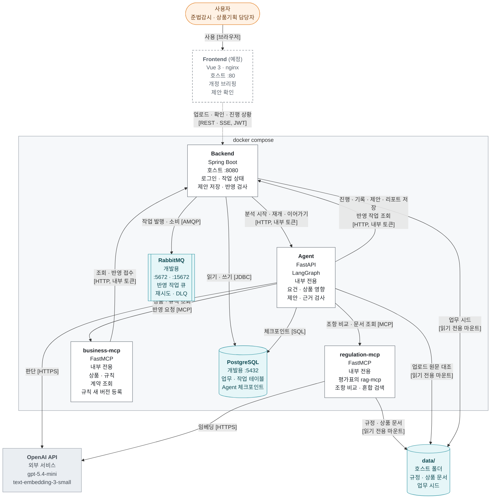
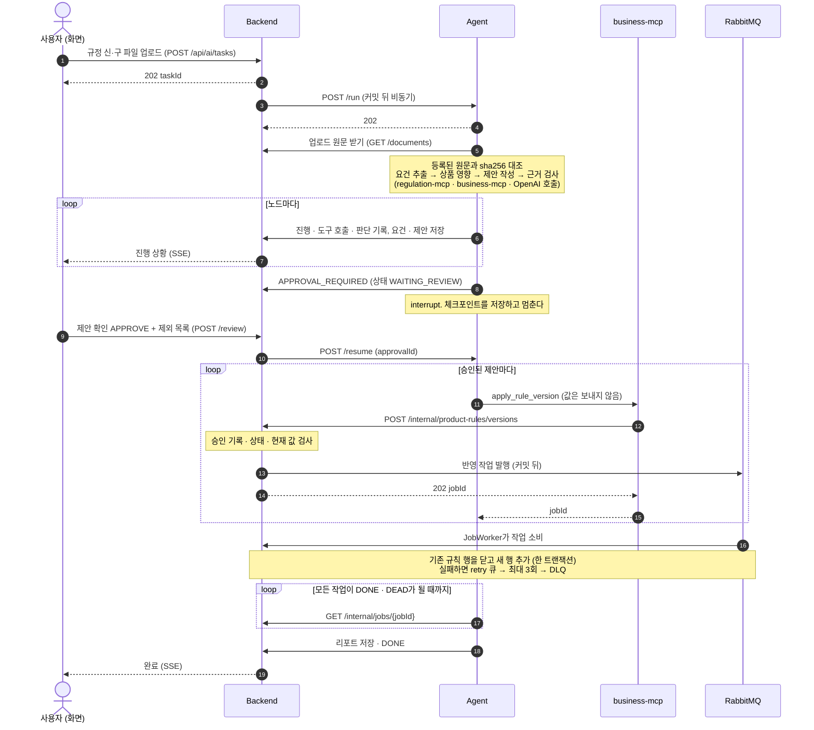
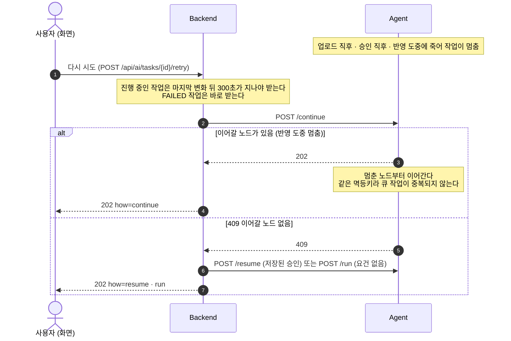
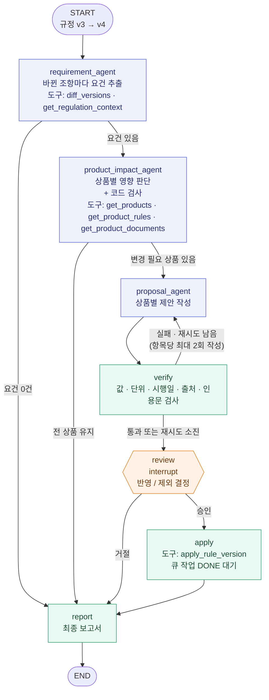

# 아키텍처

Rule Ripple이 어떤 서비스로 이루어져 있고, 서로 어떻게 부르는지 정리한다.
그림은 **지금 main**(2026-10-21, `docker compose up`으로 띄운 상태)을 그린다. 아직 없는 것은 점선으로 표시한다.
제품 방향은 [SIMPLIFICATION.md](./SIMPLIFICATION.md), 서비스 사이 계약은 [BACKEND_API.md](./BACKEND_API.md) 10절, 품질 특성별 설계 근거는 [QUALITY_25010.md](./QUALITY_25010.md)가 기준이다.

## 1. 시스템 구성도

화살표는 **부르는 쪽 → 불리는 쪽**, 라벨은 **목적 [방식]** 이다. 노드마다 호스트에 열린 포트를 적었다.
색: 주황 = 사람, 흰색 = 우리가 만든 서비스, 청록 = 저장소, 회색 = 외부 서비스. 점선 테두리 · 점선 화살표 = 아직 없음.

| 서비스 | 하는 일 | 코드 |
|---|---|---|
| Frontend | Spring만 부른다. Agent · MCP는 직접 부르지 않는다. 컨테이너와 새 화면은 아직 없다 | `frontend/` |
| Backend | 로그인(JWT), 작업 상태, 제안 저장, 반영 요청 검사와 큐 처리, "다시 시도". 업무 규칙은 여기 한 곳에만 둔다 | `backend/` |
| Agent | 규정 개정을 분석해 상품별 변경 제안을 만든다. 요청은 바로 202를 돌려주고 그래프는 백그라운드에서 돈다. compose에서는 `live` 모드(자료는 MCP로)와 Postgres 체크포인트로 뜬다 | `agent/` |
| regulation-mcp | 규정 버전 비교 · 조항 조회 · 규정과 상품 문서 혼합 검색 (의미 + BM25) | `mcp/regulation-mcp/` |
| business-mcp | 상품 · 규칙 · 계약 조회, 규칙 새 버전 등록, 반영 작업 조회. Spring 응답을 가공하지 않고 전달한다 | `mcp/business-mcp/` |

- `/internal/**`은 네트워크로 막지 않는다. Backend 포트가 호스트에 열려 있어서 `X-Internal-Token`이 유일한 경계다 ([QUALITY_25010.md](./QUALITY_25010.md) 2.6).
- 정답지(`eval/`)는 어느 컨테이너에도 마운트하지 않는다. 컨테이너가 읽는 호스트 폴더는 `data/` 아래 필요한 폴더뿐이다.

## 2. 핵심 흐름

### 2.1 업로드부터 반영까지

- Backend와 Agent는 서로 응답을 기다리지 않는다. 요청은 202로 바로 받고, 결과는 콜백으로 돌려준다.
- Agent는 반영할 값을 보내지 않는다. Backend가 저장된 제안에서 값을 꺼내므로 사용자가 확인한 값만 들어간다.
- 도구 호출(`TOOL_START` · `TOOL_END`)과 상품별 판단(`DECISION`)은 상태를 바꾸지 않는 기록 이벤트다. `scripts/trace.py`로 읽는다.

### 2.2 다시 시도: Agent가 도중에 멈췄을 때

- 확인 대기에서 `FAILED`가 된 작업은 Agent를 부르지 않고 확인 대기로 되돌린다 (`how=waiting`).
- Agent 연결이 안 되면 503이고 작업은 다시 `FAILED`가 된다. 코드는 `TaskController.retryTask`, `RetryGuard`.

## 3. Agent 그래프

색: 파랑 = LLM 판단, 초록 = 코드, 주황 = 사람.

| 노드 | 담당 | Backend 상태 |
|---|---|---|
| `requirement_agent` | LLM | `EXTRACTING` |
| `product_impact_agent` | LLM이 판단하고, 코드가 고른 규칙을 다시 본다 (판매 중단 · 다른 조항을 따르는 규칙 · 새 값을 정할 수 없는 규칙 · 이미 기준 충족). 모델 판단과 최종 판단을 `DECISION`으로 남긴다 | `LOCATING` |
| `proposal_agent` | LLM | `DESIGNING` |
| `verify` | 코드 (재작성한 항목만 LLM이 요청 반영 여부를 한 번 더 확인) | `VERIFYING` |
| `review` | 사람 (interrupt, 체크포인트로 재개) | `WAITING_REVIEW` |
| `apply` | 코드 (멱등키 `{taskId}:apply:{proposalKey}`) | `PUBLISHING` |
| `report` | 코드 | `DONE` · `NO_CHANGE` · `REJECTED` · `FAILED` |

- 그래프 정의는 `agent/app/graph.py`. 노드마다 쓸 수 있는 도구를 정해 둔다 (`NODE_TOOLS`). 쓰기 도구 `apply_rule_version`은 `apply` 노드에만 있다.
- 영향 판단의 코드 검사는 `agent/app/validation.py`의 `change_problem`이다.
- CLI 검토(`run.py`)에는 수정 요청 → `proposal_agent`, 일부만 검토 → `review` 경로가 더 있다. Backend 경로에서는 쓰지 않아서 그림에서 뺐다.

## 4. 품질 특성

품질 특성별 위험 · 설계 · 위치 · 확인은 [QUALITY_25010.md](./QUALITY_25010.md)에 있다. 이 문서의 그림과 이어지는 곳만 적는다.

| 그림 | QUALITY_25010.md |
|---|---|
| 1절 호스트 포트 · 내부 토큰 · 읽기 전용 마운트 | 1절 신뢰 경계, 2.6 보안성 |
| 2.1 반영 흐름 (값을 보내지 않음 · 승인 재검사 · 한 트랜잭션 · 재시도 · DLQ) | 2.5 신뢰성, 2.6 보안성, 2.9 안전성 |
| 2.2 다시 시도 | 2.5 신뢰성 |
| 3절 근거 검사 · 영향 판단 코드 검사 | 2.1 기능 적합성 |

## 5. 그림에 없는 것 · 알려진 한계

2026-10-21 main 기준. 전체 한계는 [QUALITY_25010.md](./QUALITY_25010.md) 4절.

| 항목 | 지금 | 메모 |
|---|---|---|
| Frontend | compose 서비스가 주석 처리돼 있고, main에는 `HomePage`와 MSW 가짜 서버만 있다 | 백엔드 API는 모두 있다. 실서버 연결은 [FRONTEND_PLAN.md](./FRONTEND_PLAN.md) 할 일 8번 |
| 업로드 원문 | 업로드한 파일을 분석하지 않고, 등록된 `credit-loan-ops` 원문을 분석한다. sha256이 다르면 `FAILED` | 그래서 2.1에서 Agent가 원문을 대조만 한다 |
| 계약 영향 | Backend의 저장 · 조회 API(`PUT /contract-impacts`)는 있지만 Agent가 아직 보내지 않는다 | 2.1에 넣지 않았다 |
| 실행 중 `/continue` | 계약(BACKEND_API 10.4)은 Agent가 실행 중인 thread면 423으로 거절하라고 하지만, main의 Agent에는 아직 없다 | 지금은 Backend의 300초 대기만 겹침을 막는다. 그래서 2.2에 423 경로를 넣지 않았다 |
| 개발용 포트 | Postgres · RabbitMQ 포트가 호스트에 열려 있다 | 제출할 때 닫을 수 있다 (compose 주석) |
| [PROJECT.md](./PROJECT.md) 4절 흐름도 | 단순화 전 설계 (코드 수정 · PR) | 지금 흐름은 이 문서 3절 |
